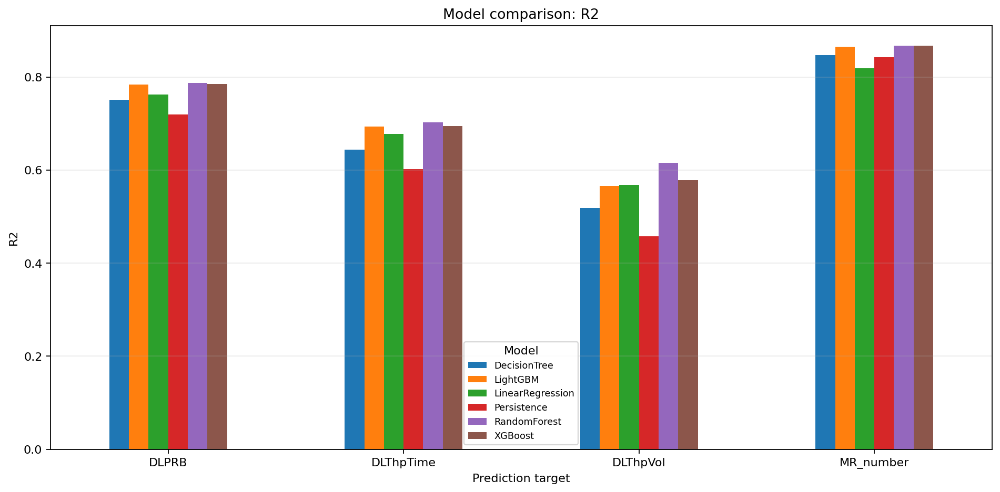

# 基于 AI 的 5G 网络关键性能指标预测与异常检测系统：项目技术报告

**报告日期：**2026-10-23  

## 摘要

本项目面向 5G 网络运维场景，围绕下行物理资源块相关指标（DLPRB）、下行流量体积（DLThpVol）、下行传输时间（DLThpTime）及测量报告数量（MR_number）四个 KPI，构建了一套集数据预处理、下一小时预测、异常候选识别、关联统计和 Web 可视化于一体的离线 AI 分析原型。项目早期开展了free5GC/UERANSIM 5G仿真网络连通性与控制面、用户面协议抓包实验；机器学习部分采用公开 gotsf-ds 波束级 KPI 时间序列。

公开数据涵盖 2,880 个波束、840 个小时、合计 2,419,200 条波束小时观测。训练与测试按时间先后划分为 672 与 168 小时，模型对 483,840 条测试观测进行评估。使用传统 ML 与 LSTM、GRU、Transformer 进行下一小时预测。保存的历史实验中，GRU 在 DLPRB、DLThpTime、MR_number 上取得最高 R²（分别约 0.808、0.715、0.886）；RandomForest 在 DLThpVol 上取得最高 R²（约 0.615）。异常检测采用 3σ、IQR、Isolation Forest 和 One-Class SVM；对完整测试集使用 `IsolationForest AND (3σ OR IQR)` 产生 3,165 条共识异常候选，占 0.65%。由于数据集不含已验证故障标签，这些仅是异常候选，不代表已确诊的网络故障。

最终系统采用 Python、Pandas、scikit-learn、PyTorch、Streamlit 和 WebSocket 构建模块化离线 Web 应用，提供训练参数设置、权重版本选择、推理以及实时日志查看等功能。

## 1. 背景、目标和系统边界

5G 网络产生大量动态变化的性能测量数据。基于历史 KPI 的短时预测有助于提前观察性能趋势，异常检测可将海量观测压缩为人工优先排查的候选事件。项目计划要求先搭建 5G 仿真环境并完成协议分析，再建立 KPI 时间序列与预测、异常检测模块，最后使用 Web 平台统一展示并完成技术报告与演示。

## 2. 总体架构与实现

系统的逻辑架构：

```text
free5GC / UERANSIM 协议实验（独立实验支线）
                  │
公开 gotsf-ds 数据获取 → 数据审计与预处理 → 时间对齐、训练集标准化
                                              ├─ 传统 ML 预测
                                              ├─ LSTM/GRU/Transformer 预测
                                              └─ 3σ / IQR / IF / OCSVM 异常检测
                                                   │
                              权重和实验版本管理、推理与评估
                                                   │
                        Streamlit Web + WebSocket 实时日志
```

具体职责分别位于 `src/core/`（通用配置）、`src/data/`（数据处理）、`src/models/`（算法、训练、推理）、`src/analysis/`（统计分析）、`src/services/`（训练任务与模型版本）、`src/ui/`（Web 页面）。`app.py` 是应用启动入口。神经网络定义统一保存在 `src/models/architectures.py`，可供训练与推理复用。更多结构细节见 `docs/ARCHITECTURE.md`。

## 3. 数据集与数据预处理

实验选择公开 gotsf-ds 波束级 KPI 数据集。四项分析字段为：`DLPRB`、`DLThpVol`、`DLThpTime`、`MR_number`。项目按波束、基站、小区以及小时序号组织面板数据：

| 项目 | 历史实验记录 |
|---|---:|
| 波束数 | 2,880 |
| 小时数 | 840 |
| 总波束小时记录 | 2,419,200 |
| 训练区间 | Time = 0–671，672 小时 |
| 测试区间 | Time = 672–839，168 小时 |
| 训练记录 | 1,935,360 |
| 测试记录 | 483,840 |

数据预处理包含字段检查、时间轴完整性、缺失及异常值检查、按波束对齐、标准化/归一化。项目将 StandardScaler / MinMaxScaler 参数限定在训练区间上估计后应用于测试集，避免测试分布信息进入训练统计量。传统 ML 特征工程构建滞后 1、2、24、168 小时的特征及下一小时预测目标。相关统计文件：`reports/preprocessing_summary.json`、`reports/ml_feature_summary.json`。

数据下载模块从公开 `netop/gotsf-ds` 数据集获取四个固定原始 CSV 文件，保存到 `data/raw/`。审计与预处理分别由 `python -m src.data.audit_kpi_data` 和 `python -m src.data.preprocess_kpi_data` 执行，预处理输出位于 `data/processed/kpi_timeseries.csv`。特征工程脚本 `python -m src.data.build_ml_features` 输出 `data/processed/ml_features.pkl`，作为传统 ML 训练的输入。

`data/` 中的大型文件没有上传 GitHub。

## 4. KPI 预测实验

### 4.1 实验协议和模型

目标是在时间 `t` 已有观测的基础上预测 `t+1` 小时 KPI，训练/测试按时间划分。基线模型为 Persistence（上一观测保持不变）。传统模型包括 LinearRegression、DecisionTree、RandomForest、XGBoost、LightGBM；深度学习包括 LSTM、GRU、Transformer。评估采用 MAE、RMSE、R²，指标在原始 KPI 数值尺度报告。

不同模型的特征和训练机制存在差异，最终比较以保存的同一测试集评估结果为准。

### 4.2 历史预测结果

下表汇总每项 KPI 的历史最佳 R² 模型，以及 Persistence 作为可解释基准的 MAE：

| KPI | 最佳历史 R² 模型 | R² | 对应 MAE | Persistence MAE | MAE 相对改善 |
|---|---|---:|---:|---:|---:|
| DLPRB | GRU | 0.808 | 0.2456 | 0.2982 | 17.64% |
| DLThpVol | RandomForest | 0.615 | 0.2076 | 0.2378 | 12.68% |
| DLThpTime | GRU | 0.715 | 0.2298 | 0.2793 | 17.72% |
| MR_number | GRU | 0.886 | 0.2097 | 0.2459 | 14.71% |

数据源：`reports/week3/w3_ml_dl_all_metrics.csv`、`reports/model_metrics.csv`。

结果表明不同 KPI 的最佳算法并不完全一致：GRU 对三个目标取得较好的拟合，DLThpVol 的最佳 R² 来自 RandomForest。原因可能与特征、分布、非平稳性及模型归纳偏置有关。

### 4.3 实验图表及模型比较

历史传统 ML 的逐小时预测汇总保存在 `reports/prediction_timeseries.csv`；深度学习有 `reports/w3_lstm_hourly_predictions.csv`、`w3_gru_hourly_predictions.csv`、`w3_transformer_hourly_predictions.csv`，对应预测图在 `figures/`。第 5 周的跨系列比较由 `src/analysis/compare_model_performance.py` 读取保存的模型指标并形成报告。



图 1. 历史模型 R² 可视化。

### 4.4 评价指标与展示边界

MAE 反映平均绝对偏差，RMSE 对大误差更敏感，R² 反映相对于基线均值的拟合程度。三个指标应联合解释。项目原有 Streamlit 预测/模型评估页面显示保存的历史实验 CSV；它们**不会因为用户选择了另一权重版本而自动变为那个版本的评估指标**。

## 5. KPI 异常检测

### 5.1 方法

- **3σ**：根据训练区间各波束 KPI 的均值与标准差设置阈值。
- **IQR**：根据训练分位数及四分位距设置上下界。
- **Isolation Forest**：使用标准化 KPI 与因果一阶差分构成的特征，识别与训练分布不同的样本。
- **One-Class SVM**：在采样子集上训练和测试，避免全量样本带来的计算成本。
- **共识筛选**：`IF AND (3σ OR IQR)`，要求 IF 与至少一个统计检测方法同时提示异常。

### 5.2 保存的检测结果

| 方法 | 标记波束小时数 | 标记比例 |
|---|---:|---:|
| 3σ | 22,059 | 4.56% |
| IQR | 51,318 | 10.61% |
| Isolation Forest | 9,900 | 2.05% |
| 共识规则 | 3,165 | 0.65% |

上表分母均为完整测试集的 483,840 条波束小时记录。One-Class SVM 的 4.60% 结果仅来自 12,000 条测试抽样，不应直接与完整测试比例并列比较。

IQR 的标记比例比 3σ 高，这一现象可能与阈值宽度、训练分布偏斜/厚尾和时序分布漂移有关。更完整的统计检验与分布指标见 `reports/w4_anomaly_diagnostics_report.md`。

### 5.3 KPI 关联和根因分析边界

在 3,165 条共识候选记录中进行了 KPI 两两相关性分析。保存的结果显示 DLPRB 与 MR_number 的 Pearson 相关系数约 0.889；DLPRB 与 DLThpTime 约 0.697。分析使用以基站为重采样/聚类单位的区间或显著性检验，并对多个比较使用 Holm 校正。然而**相关性不是根因证据**：无法根据共现关系直接推断设备故障、拥塞或无线覆盖问题。由于缺少已验证故障标签，不能报告检测 Precision、Recall、F1，也不能评价真正的故障告警正确率。

## 6. 第四阶段集成：Web 应用和实验管理

项目使用 Streamlit 构建统一交互界面，支持：

1. 原始数据文件状态查看、数据审计和预处理任务触发。
2. 传统 ML、LSTM、GRU、Transformer 和异常检测训练入口；DL 可调整 Epoch、Batch Size、LR、隐藏维度、序列长度、季节性间隔、早停、训练上限、随机种子及 CPU/CUDA；异常检测可调整污染率和抽样参数。
3. 后台工作进程执行受控命令。WebSocket 将标准输出/错误流事件驱动发送到页面。
4. 模型权重归档和版本化选择。对可信本地 `.pt`、`.pkl` 模型提供加载入口，保留深度学习 `.json` 元数据和训练参数记录。
5. 基于 CSV 的下一小时 KPI 推理；异常模型也可加载对齐的 KPI 面板输出候选标记及 CSV。
6. 历史实验总览、预测曲线、算法比较、异常统计及 KPI 相关性展示。

当前原型是本机离线工具，使用手册见 `USER_GUIDE.md`。2026-10-23 对传统 ML Web 训练增加独立实验目录和抽样验收参数；该新增入口的实际运行结果不能沿用此前 GRU/异常检测的验收记录。

## 7. 测试、问题排查与性能

项目包含以合成数据为基础的推理往返测试、模型归档测试、结构测试、训练参数校验测试和 Windows UTF-8 输出测试。系统开发期间发现并修复了两个典型问题：

- 旧深度学习训练将不同标准化配置的结果合并写入同一历史报告时，触发 `train_scale_mean` 冲突。解决方式：Web 每次训练使用独立实验目录，并将对应权重与训练参数一起归档。
- Windows GBK 子进程无法输出 `R²` 特殊字符，抛出 `UnicodeEncodeError`。解决方式：为后台 Python 子进程统一设置 UTF-8 I/O 编码。

仓库中已设置三类可离线检查的测试：模型预测/异常推理的合成数据往返测试、模型权重版本与训练配置测试、代码和历史报告契约测试。建议在项目根目录执行：

```powershell
python -m pip check
python -m compileall -q src app.py
python -m unittest discover -s tests -v
python -m unittest test_inference test_model_registry -v
```

随后运行 `python -m src.data.prepare_demo_inputs`，使用生成的预测与异常检测 CSV 在 Web 中**实际点击**运行、导出。

### 7.1 2026-10-23 本机交互验收记录

以下记录来自本机 PowerShell 测试输出、Web 操作反馈与异常推理页面截图，**与第 4～6 周保存的完整正式训练成绩区分**。

| 验收内容 | 观察与结果 | 结论 |
|---|---|---|
| 自动化测试 | `tests/` 下 21 项通过；`test_inference` 与 `test_model_registry` 共 5 项通过 | 26/26 通过（针对当时的本地代码） |
| 依赖及语法 | `python -m pip check` 与 `python -m compileall -q src app.py` 经用户确认无问题 | 通过 |
| Streamlit 页面 | 系统可启动；总览、历史预测、模型评估、异常统计、KPI 关联展示无异常；原始与处理后数据文件状态检查正常 | 通过 |
| GRU Web 训练 | Epoch 3、Batch 64、训练上限 512、验证上限 512；日志显示 CPU 上三轮训练和全部 483,840 条测试观测的评估，独立保存模型和报告 | 通过 |
| GRU 预测推理 | 通过 Web 选择新发布的 `.pt` 权重，上传预测历史 CSV，生成预测并导出 CSV | 通过 |
| 已有异常模型推理 | 上传与波束集合匹配的异常历史 CSV；页面显示五种候选标记及统计，成功导出 CSV | 通过 |
| 异常检测 Web 训练 | IF 训练抽样 2,048、SVM 训练抽样 300、测试抽样 500；完成四阶段检测、结果图表/CSV 保存及 `anomalies.pkl` 发布 | 通过 |
| 新异常模型回载 | 使用本次发布的新 `anomalies.pkl` 重新进行 Web 推理及 CSV 导出，用户反馈无异常 | 通过 |
| 传统 ML Web 训练 | 代码已补独立目录、快速抽样入口及相关回归测试；**这些后续改动尚未在本机实测**，全量训练亦未重跑 | 待新版验收 |

GRU 验收实验标识：`gru_20261023T071632Z_9c47c2`；训练/验证 MSE 从 0.56009/0.90384 变为 0.45019/0.74328。四 KPI 测试 R² 分别为 DLPRB 0.230083、DLThpVol 0.281376、DLThpTime 0.150301、MR_number 0.348125；这是 **512 条抽样训练数据、仅 3 Epoch** 的功能性测试结果，不替代第 4.2 节正式历史指标。

异常训练实验标识：`anomaly_20261023T072714Z_3ed272`。全量测试上 3σ 为 22,059/483,840（4.56%）、IQR 为 51,318/483,840（10.61%）、IF 为 11,107/483,840（2.30%）；共识规则筛出 3,478/483,840（0.72%）。One-Class SVM 为 **45/500（9.00%，抽样子集）**，分母不同不得直接比较。这也是改变模型抽样量后的验收实验，不能覆盖第 5.2 节保存的历史结果。

目前没有可靠记录各项 Web 操作的统一墙钟耗时、内存/显存峰值或跨机器部署数据，故不作性能基准结论。测试时 GRU 日志显示 `Training GRU on cpu`，不宣称该次训练使用 GPU。新增权重与实验结果处于本机被 Git 忽略的 `resources/` 目录，仓库不直接包含它们。

## 8. 局限性与未来工作

1. 数据集与仿真网络没有实时统一的采集链路；真正的在线化还需 KPI 流接入、校时、缓冲和告警服务。
2. 无故障真值标签，因此只能进行候选检测率、方法一致性及探索性相关分析。
3. One-Class SVM 使用抽样测试，不能假设其结果代表全部观测。
4. 传统 ML 新版 Web 训练已支持按实验隔离和模型发布，但本次修改还需用户本机回归验证；无 `--out` 的旧命令行仍会写到固定历史路径。
5. 当前演示版本的性能主要依靠本机运行，尚无跨设备、跨 Python 版本、压力负载下的自动验收结果。
6. 更多带标签的告警、无线质量测量（如 RSRP、SINR）、流量上下文和设备日志有助于提升后续故障诊断可靠性。

## 9. 结论

项目完成了以公开 5G 波束级 KPI 数据为核心的离线预测、异常候选检测和 Web 系统原型开发。历史实验表明 GRU 和 RandomForest 在不同目标上的预测表现各有优势；通过多方法交叉筛选，将完整测试集的异常候选缩减到 3,165 条，便于进一步人工分析。工程部分提供了统一 Streamlit 页面、模型训练/版本管理及流式训练日志，为后续实际部署奠定基础。
